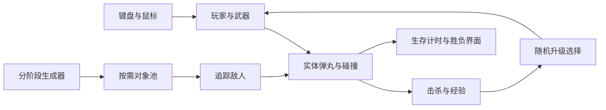

# ROGue Survivor

Unity 2D 顶视角生存游戏：环绕近战、鼠标射击、敌人波次与随机升级选择。

**简体中文** · [English](README_EN.md) · [日本語](README_JA.md)

**深入阅读：** [技术说明](docs/technical-notes.zh-CN.md) · [部署与操作](docs/setup.zh-CN.md)

ROGue Survivor 是一个以五分钟单局为核心的课程游戏工程。项目将玩家移动、武器、直接追踪敌人、对象复用、地形重定位、成长、界面与音频接入同一场景。重点是完整玩法循环和组件协作；旧版“500敌人／144 FPS／零GC”的性能结论没有可复核记录，不作为当前成果。

## 游戏循环与系统结构

`SampleScene`是唯一加入Build Settings的游戏场景。场景配置300 s单局、100生命、四阶段刷怪；升级与暂停通过Time.timeScale控制时间，死亡／时间到进入结算。

## 已接入的玩法与工程设计

| 模块 | 实际内容 |
| :--- | :--- |
| 玩家／输入 | Input System的移动消息、Rigidbody2D位置更新；鼠标瞄准，按住左键按间隔发射。 |
| 战斗 | 环绕撬棍、速度10的实体枪弹、穿透计数、碰撞伤害、受击冲量与死亡动画。 |
| 敌人与场地 | 四组刷怪参数；敌人沿玩家方向移动，四块Ground通过Area退出事件重定位。 |
| 对象复用 | 三类预制体桶，线性寻找闲置对象；不足时Instantiate，失活后复用。 |
| 成长 | 击杀直接加经验；五份ScriptableObject定义近战、手枪、手套、鞋、治疗；过滤满级非消耗品后，无放回抽取最多三项。 |
| UI／音频 | HUD、暂停、升级与结算按钮；BGM及16个效果音播放通道，暂停／升级启用高通滤波。 |

[源码、公式、场景参数和边界](docs/technical-notes.zh-CN.md)。Scanner计算最近敌人，但枪械实际瞄准鼠标，不使用自动锁敌。

## 展示与验证范围

升级、胜利与开局截图见[历史画面](docs/technical-notes.zh-CN.md#evidence)。画面记录不等同于负载、帧率或GC评测。

本轮阅读全部19个C#脚本，并静态追踪场景、预制体、五个物品资源和动画事件；没有启动Unity、构建可执行文件或进行Play Mode测试。

## 打开与运行

1. 使用项目记录的 **Unity 2022.3.17f1c1** 打开包含Assets、Packages、ProjectSettings的根目录。
2. 让Package Manager恢复锁定包，核对URP14.0.9、Input System1.7.0和Cinemachine2.9.7。
3. 打开`Assets/Scenes/SampleScene.unity`，确认控制器、场景引用和输入设置，进入Play后点击开始。
4. WASD／方向键移动，鼠标瞄准、左键持续开火，Esc暂停，点击升级卡选择。[完整步骤](docs/setup.zh-CN.md)。

## 实现边界与后续

对象池没有预热或容量上限，扫描是O(n)，新敌人／子弹不足时仍分配；升级和扫描等代码也有分配，不能保证0 B/Frame。敌人没有A*或流场寻路，枪械不是命中扫描射线；地图复用不是程序化关卡生成。

后续以实际游戏验收输入、敌人接触、资源回收和各级升级，再用 Profiler 建立固定负载基准。升级先过滤满级非消耗品，再无放回选取最多三项；若可用项目少于三项，只显示实际可用项，治疗不重复。

## 归属与许可

仓库由 **刘超然 / Chaoran Liu** 维护，介绍课程游戏实现；没有足以细分全部脚本与素材原创归属的记录。Unity、包、像素画和音频不是因为同仓库就自动成为个人原创。

代码许可见[MIT](LICENSE)。第三方图像／音频素材的具体来源与授权仍需补齐，不能把代码许可扩大为全部素材授权。[技术说明](docs/technical-notes.zh-CN.md) · [运行指南](docs/setup.zh-CN.md)

## 维护修订与验证

2026-10 修复版移除了Jump直接升级的测试入口；鞋子倍率基于 `Player.Awake` 记录的场景初始速度，不再使用固定3；持续碰撞只对Enemy标签造成玩家伤害；环绕武器角度改为 `360f/count`，避免不能整除时的整数截断。

使用本机Unity 2022.3.17f1c1自带Roslyn和现有程序集引用，完整编译19个应用C#脚本通过，输出全部在隔离缓存。未启动Editor、运行Play Mode、导出平台包或执行Profiler；测试仍需覆盖敌人接触/地形接触、鞋子各级和非整除数量环绕布局。

本轮另用实际 `LevelUp.Next` 和隔离的 Unity 接口替身，对 5 种候选状态执行 500 轮选择检查：正常、只剩治疗、仅两项、没有有效项及不足三项输入；均通过。19 个应用 C# 脚本仍编译通过。测试源码在 [Tests](Tests/UpgradeSelectionRegression.cs)，不位于 Assets，也不替代 Play Mode。
