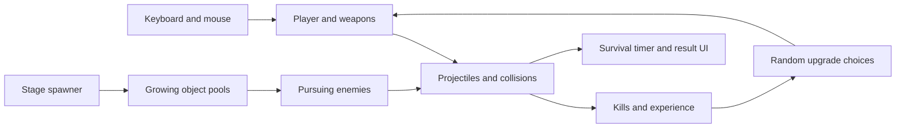

# ROGue Survivor

A Unity 2D survivor-like game with orbiting melee, mouse-directed projectiles, enemy stages, and random upgrades.

[简体中文](README_ZH.md) · **English** · [日本語](README_JA.md)

**Explore:** [Technical notes](docs/technical-notes.en.md) · [Setup and operation](docs/setup.en.md)

ROGue Survivor is a course game built around a five-minute run. Movement, weapons, direct enemy pursuit, object reuse, terrain relocation, progression, UI, and audio are connected in one scene. Its value is the complete gameplay loop and component integration. The former 500-enemy/144-FPS/zero-GC claims lack reproducible evidence and are not retained.

## Gameplay and architecture

`SampleScene` is the only game scene enabled in Build Settings. It configures 300 seconds, 100 health, and four enemy stages. Upgrades/pause control Time.timeScale; death or expiry leads to results. `IsEnding` protects result transitions and prevents duplicate win/loss routines. Escape resumes only an actual pause, never the start menu, upgrades or result delay. Timeout takes priority over Escape in the same frame; retry restores the time scale before reloading the scene.

## Implemented systems

| System | Actual implementation |
| :--- | :--- |
| Player/input | Input System movement messages and Rigidbody2D movement; mouse aiming, held-left firing subject to cooldown. |
| Combat | Orbiting crowbars, speed 10 physical bullets, penetration counts, collision damage, knockback impulses, death animation. |
| Enemies/terrain | Four spawn configurations; direct pursuit; four Ground chunks relocate on Area exit. |
| Reuse | Three prefab buckets; linear inactive-object search, Instantiate when exhausted, reuse after deactivation. |
| Progression | Kills directly grant experience; five ScriptableObjects define melee, pistol, gloves, shoes, heal; up to three eligible items are sampled without replacement. |
| UI/audio | HUD/pause/upgrades/results; BGM and 16 SFX channels; high-pass filtering during pause/upgrades. |

[Source, equations, scene parameters, and limits](docs/technical-notes.en.md). Scanner finds nearest targets, but current firearm aiming uses the mouse, not automatic targeting.

## Demonstration and validation

See [historical upgrades, victory, and opening](docs/technical-notes.en.md#evidence). Screenshots are not load/FPS/GC measurements.

All 19 C# scripts were read and scene/prefab/five-item/animation links inspected. Unity, executable builds, and Play Mode tests were not run.

## Open and play

1. Open the Assets/Packages/ProjectSettings root using the recorded **Unity 2022.3.17f1c1**.
2. Restore locked packages; inspect URP 14.0.9, Input System 1.7.0, and Cinemachine 2.9.7.
3. Open `Assets/Scenes/SampleScene.unity`, inspect references/input, enter Play, and click Start.
4. WASD/arrows move, mouse aims, held left fires, Esc pauses, and cards select upgrades. [Detailed setup](docs/setup.en.md).

## Limits and further work

Pools have no prewarming/capacity limit and search in O(n). Exhausted pools still instantiate; scanning/upgrades allocate too, so 0 B/Frame is unsupported. Enemies use neither A* nor flow fields; firearms are not hitscan; relocated terrain is not procedural level generation.

Next validate input, enemy contact, recycling and upgrades in gameplay, then profile a fixed load. Upgrade selection filters exhausted non-consumables before sampling up to three without replacement; fewer available items produce fewer choices, with no duplicate heal fallback.

## Attribution and license

Maintained by **Chaoran Liu / 刘超然** as a course game. Records do not establish original authorship of every script/asset. Unity/packages/pixel art/audio are not personal original work merely because they are included.

Code license: [MIT](LICENSE). Specific third-party visual/audio sources and permissions still need documentation; code licensing does not license every asset. [Technical notes](docs/technical-notes.en.md) · [Setup](docs/setup.en.md)

## Maintenance and validation

The 2026-10 revision removes the Jump-to-upgrade debug path, bases shoe multipliers on scene speed captured in `Player.Awake` instead of a hard-coded 3, limits player contact damage to Enemy-tagged objects, and uses `360f/count` for evenly spaced orbiting weapons without integer truncation.

All 19 application C# scripts compile with the installed Unity 2022.3.17f1c1 Roslyn compiler and existing assembly references, with outputs isolated in task cache. No Editor, Play Mode, platform export or Profiler run occurred. Enemy/terrain contact, all shoe levels and non-divisor orbit counts still need gameplay validation.

The actual `LevelUp.Next` passes 500 selections across five availability scenarios using isolated Unity-interface stubs: normal, heal only, two remaining, no eligible item and fewer than three inputs. All 19 application C# scripts also compile. The [standalone harness](Tests/UpgradeSelectionRegression.cs) is outside Assets and does not replace Play Mode.
