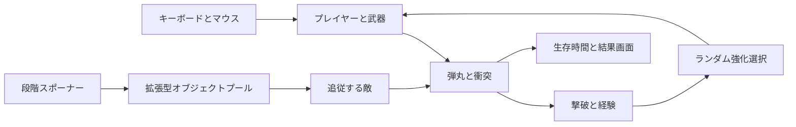
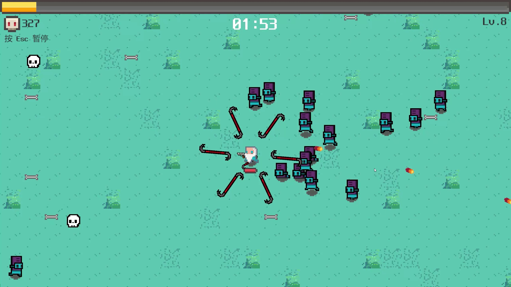

# ROGue Survivor

周回近接武器、マウス射撃、敵の段階生成、ランダム強化を備えるUnity 2Dサバイバルゲームです。

[简体中文](README.md) · [English](README_EN.md) · **日本語**

**詳細：** [技術ノート](docs/technical-notes.ja.md) · [導入と操作](docs/setup.ja.md)

ROGue Survivorは5分間の1プレイを中心とする授業制作です。移動、武器、敵の直接追従、オブジェクト再利用、地形再配置、成長、UI、音声を1シーンに接続しています。遊びの一巡とコンポーネント連携を示し、旧500体・144 FPS・ゼロGCの成績は再現根拠がなく引き継ぎません。

## ゲームの流れと構成

Build Settingsの有効ゲームシーンはSampleSceneのみです。300 s、HP100、敵4段階を設定し、強化・ポーズはTime.timeScale、死亡・時間満了は結果画面へ接続します。

## 接続済みの仕組み

| 部分 | 実装 |
| :--- | :--- |
| 入力・移動 | Input Systemメッセージ、Rigidbody2D移動、マウス照準と長押し連射。 |
| 戦闘 | 周回バール、速度10の実体弾、貫通回数、衝突ダメージ、衝撃と死亡アニメーション。 |
| 敵・地形 | 4生成設定、プレイヤーへの直接追従、Area退出で4つのGroundを再配置。 |
| 再利用 | 3種のプレハブを線形探索し、不足時Instantiate、非活性化後に再利用。 |
| 成長 | 撃破で直接経験を加え、近接・拳銃・手袋・靴・治療の5設定から異なる索引を抽出。 |
| UI・音声 | HUD・ポーズ・強化・結果、BGMと効果音16チャンネル、ポーズ／強化時ハイパス。 |

[ソース・式・シーン値と制約](docs/technical-notes.ja.md)。Scannerは最寄り敵を計算しますが、現行の銃はマウス照準で、自動ロックオンではありません。

## 画面と検証範囲

[強化・勝利・開始画面](docs/technical-notes.ja.md#evidence)を保存しています。画面は負荷・FPS・GC試験ではありません。

今回19本のC#を読み、シーン・プレハブ・物品5個・アニメーションイベントを静的に追跡しました。Unity起動、実行ファイル作成、Play Mode試験は行っていません。

## 開いて実行

1. Assets／Packages／ProjectSettingsを含むルートを記録版**Unity2022.3.17f1c1**で開きます。
2. Package Managerで復元し、URP14.0.9、Input System1.7.0、Cinemachine2.9.7を確認します。
3. SampleSceneを開いて参照・入力を照合し、Playで開始ボタンを押します。
4. WASD／矢印で移動、マウス照準と左長押し、Escポーズ、カード選択です。[導入](docs/setup.ja.md)。

## 制約と今後

プールは事前生成・上限なし、探索O(n)で、不足時には生成します。走査・強化も割当てがあり0 B/Frameとは言えません。敵はA*・流場ではなく、銃はヒットスキャンではなく、地形再利用は自動ステージ生成ではありません。

Jumpデバッグ強化、最大レベル代替で選択肢が3未満になる挙動、靴基速とシーンの差を先に整えます。その後入力・戦闘・回収を試し、固定負荷のフレーム時間とメモリをProfilerで測る方針です。

## 帰属とライセンス

**刘超然 / Chaoran Liu**が授業ゲームを管理しています。全スクリプト・素材の独自著作を確定する記録はなく、Unity・パッケージ・ドット絵・音声を同梱しただけで個人の創作物とはしません。

コードは[MIT](LICENSE)。画像・音声の個別出典と許諾は追記が必要で、コード許諾を全素材へ拡張しません。[技術ノート](docs/technical-notes.ja.md) · [導入](docs/setup.ja.md)

## 保守と検証

2026-10版ではJumpによる直接強化を削除し、靴は固定3ではなく `Player.Awake` で記録するシーン初速を基準にしました。接触ダメージをEnemyタグに限定し、周回武器は `360f/count` で整数切捨てなく配置します。

Unity 2022.3.17f1c1付属Roslynと既存アセンブリ参照でアプリC#19本のコンパイルが通過し、出力は隔離キャッシュ内です。Editor起動、Play Mode、プラットフォーム出力、Profilerは未実施です。敵・地形接触、靴の全段階、割り切れない周回個数は実プレイで確認が必要です。
