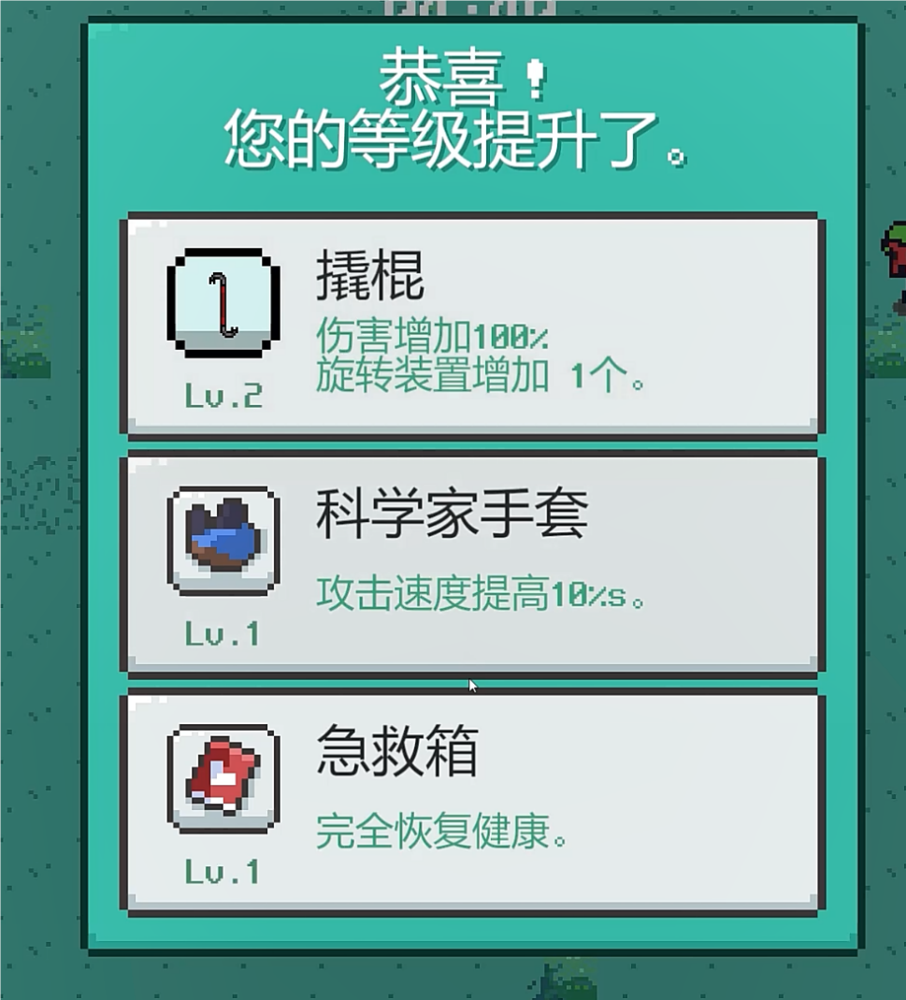
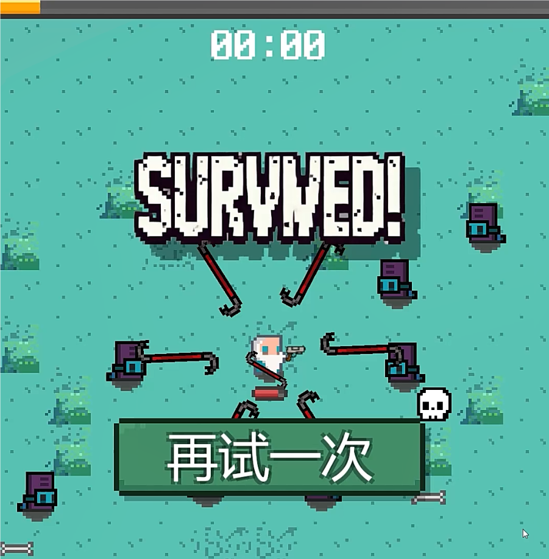
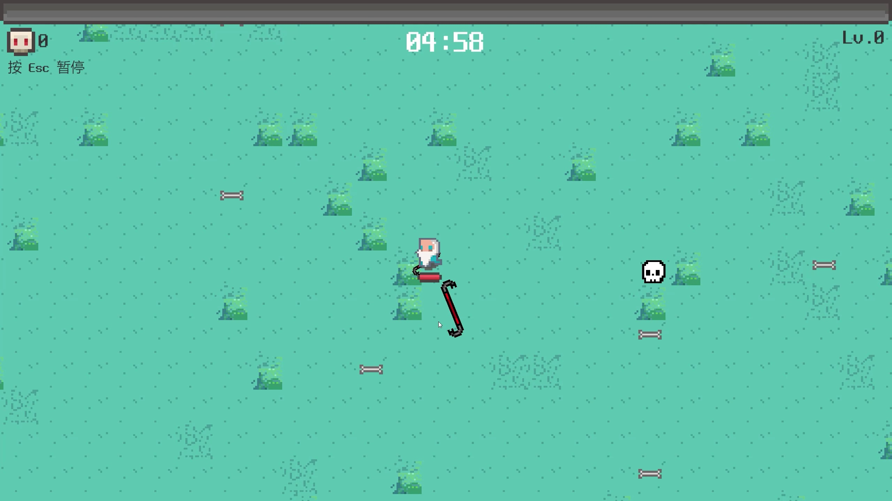

# ROGue Survivor — Technical notes

[简体中文](technical-notes.zh-CN.md) · **English** · [日本語](technical-notes.ja.md) · [Overview](../README_EN.md)

<a id="source-map"></a>

## Modules and serialized connections

Code directory: [Assets/ROGue Survivor/Codes](../Assets/ROGue%20Survivor/Codes).

| Scripts | Responsibility |
| :--- | :--- |
| GameManager, Player, EnemyLogic | Run state, movement/damage, pursuit/hits/death. |
| ObjectManager, Spawner, Reposition | Three prefab pools, spawn stages, terrain/enemy relocation. |
| Weapon, Bullet, Scanner | Orbit/mouse fire, penetration/recycling, nearest-target scanning. |
| ItemData, Item, LevelUp, Gear | Five configurations, creation/upgrades, sampling, modifiers. |
| Hand, HUD, CameraFollow | Held-item visuals, five HUD values, player screen-position following. |
| Pause, Result, AudioManager | Time pause, result titles, BGM/SFX. |

All19 scripts were checked against scene/prefab/assets. Weapon/Gear are added dynamically by Item, so no serialized reference does not mean unintegrated code. Four enemy death animations call`Dead`, ultimately deactivating objects for reuse.

[Scene](../Assets/Scenes/SampleScene.unity), [three prefabs](../Assets/ROGue%20Survivor/Prefabs), [five items](../Assets/ROGue%20Survivor/Data), [input](../Assets/ROGue%20Survivor/Player.inputactions).

<a id="combat"></a>

## Movement, pursuit, and projectiles

Player FixedUpdate uses inputVec×speed×fixedDeltaTime with MovePosition; serialized starting speed is4. EnemyLogic directly follows the normalized player direction without obstacle planning, then clears velocity. Knockback applies an outward impulse of3, not an elastic-collision solver:

```math
p_{t+1}=p_t+v\,\frac{p_{player}-p_t}{\lVert p_{player}-p_t\rVert}\Delta t
```

The melee Weapon rotates at default150°/s; Batch positions objects at radius1.8 with integer`360/count`angles. Pistol fires one bullet every default0.5 s while left is held. Direction uses Camera.ScreenToWorldPoint; the z-difference sign requires runtime projection review. There is no hitscan or automatic aim.

Bullet speed is10. Each Enemy trigger decrements perforation; reaching-1 deactivates it, so initial0 permits one hit. Initial-1 means orbiting objects do not exhaust on hits. Area exit also deactivates. Enemy damage/knockback leads to collider/physics disable, kill/experience, then death-event deactivation. Player OnCollisionStay does not filter Enemy tags; scene collision layers determine its actual damage scope.

<a id="pool-map"></a>

## Pooling and terrain reuse

ObjectManager.Awake allocates empty Lists only. Get linearly searches inactive entries, otherwise instantiates and appends. Worst-case search is O(n), capacity is unbounded, and no zero-allocation guarantee exists. Scanner's per-physics-frame CircleCastAll, card arrays, new Weapon/Gear, and coroutines also need profiling.

The scene has four Ground chunks, not a3×3 grid. Area exits translate horizontally56 or vertically40 based on relative position/input signs. Equal diffX/diffY outside the corner branch produces no movement. This specific rule is not a complete toroidal topology.

An active enemy leaving the area is translated relative to itself:

```math
p'_{enemy}=p_{enemy}+30\,v_{input}+\epsilon,\qquad \epsilon_x,\epsilon_y\sim U(-5,5)
```

This function does not renormalize input or sample a cone around the player; zero input leaves only random displacement.

<a id="progression"></a>

## Progression, stages, and pause

| Scene stage | Spawn interval s | Health | Speed |
| :--- | ---: | ---: | ---: |
| 0–60 s | 0.8 | 10 | 2 |
| 60–120 s | 0.6 | 15 | 2.8 |
| 120–180 s | 0.4 | 25 | 3.3 |
| After180 s | 0.3 | 37 | 3.6 |

Source uses floor(gameTime/60), clamped to the last entry; levelTime is unused. This is not exponential adaptive difficulty. Enemy death directly grants experience, without pickup/magnet systems. Thresholds are3/5/10/20/40/60/80/100/120/200 and then capped at 200.

Five items are melee, pistol, gloves, shoes, full heal, with five-entry level arrays. Initial weapon selection uses baseDamage/baseCount; later damage is base×(1+damages[level]) and count is accumulated, unlike the old six-level table. Shoes use code baseline3 versus scene speed4, potentially slowing the player on upgrade. Gloves modify orbit speed/fire interval.

Three distinct indices are sampled from five using rejection, without rarity weights. Max-level choices all map to the same items[4] heal; multiple replacements can reduce visible choices without resampling. At300 s, victory activates a10000-damage EnemyCleaner and waits 0.5 s before results; defeat also waits 0.5 s. Pause/upgrades stop time and enable AudioHighPassFilter, not low-pass.

Weapon.Update retains`Input.GetButtonDown("Jump")`calling LevelUp(10,1). Both input backends are enabled. Debug behavior and generic gamepad/touch InputActions bindings do not establish fully supported platform controls.

<a id="evidence"></a>

## Historical views and static checks

| Upgrade | Victory | Opening |
| :---: | :---: | :---: |
|  |  |  |

Manifest/lock/InputActions and scene GUID links were inspected. Forty-six non-project GUIDs resolve in local PackageCache; built-ins are separate. Three missing historical image/animation GUIDs occur only in Pal, Player0_*, and Stand1 resources outside the current scene asset graph. This is not a claim that every repository asset is complete.

No Editor run, full C# compile, Play Mode, export, or Profiler pass occurred. Screenshot levels/kills describe one moment. Unsupported144+ FPS/500 enemies/0 B per frame/draw-call/memory benchmarks were removed. Application code, settings, scenes, assets, and meta files are unchanged.
